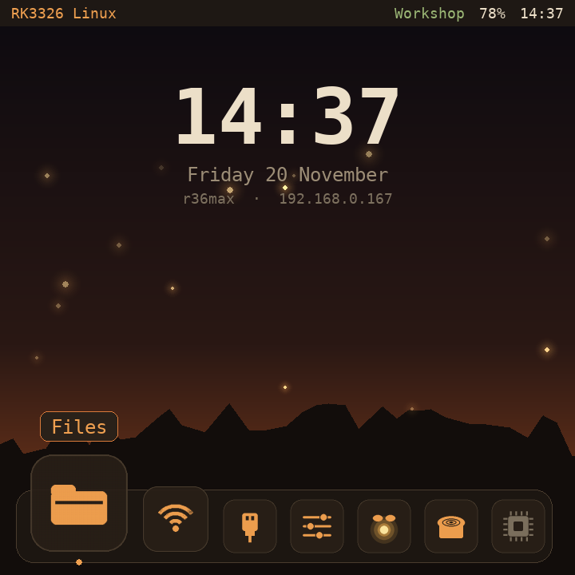

# RK3326 Linux

A small Linux system for RK3326 handhelds (R36MAX first, R36S next), built
as one SD card image: flash it, put it in the handheld, switch on.



It is our own system, not a desktop distribution squeezed onto a 4-inch
screen: a minimal Debian 13 (trixie) on the boot chain and kernels of
[arkos4clone](https://github.com/lcdyk0517/arkos4clone), meant to grow a
gamepad-first interface with the Stump, FireFly and the Provisioner as core
parts, for teaching and authorised testing on your own equipment.

> **Status: starts on an R36MAX (type 1 board), tested 2026-11-20.**
> Kernel 5.10, the screen, a USB keyboard, Wi-Fi on an RT3070 dongle, SSH,
> the data partition, power-off and restart, the speaker and charging all
> worked on that handheld. No other handheld has been tried. The build also
> checks what can be checked without hardware, including a rehearsal of the
> first start's partition step.

## What the image does

- Starts kernel **5.10** (arkos4clone calls it experimental); kernel **4.4**
  is on the card as a fallback.
- Boots to its own **desktop**, driven by the gamepad: a dock at the bottom
  whose icons grow under the cursor, and windows for Files, Network,
  Devices and Settings. A USB keyboard works too.
- Joins the Wi-Fi network you put in `wifi.txt`, or one you pick in the
  Network window, and answers **SSH**.
- Makes its own SSH host keys and a data partition at the first start.

Not in it yet: a terminal window, FireFly, the Stump, the security tools.

### The desktop

| Button | Does |
|---|---|
| D-pad left / right | move along the dock |
| A | open what is under the cursor; choose |
| B | close the window; go back |
| X | more actions (in Files) |
| START | confirm what you typed on the on-screen keyboard |
| Volume keys | volume |

Apps add themselves to the dock with one small file: see
[`overlay/usr/share/rk/apps/README`](overlay/usr/share/rk/apps/README).

A text login is always one key press away on a USB keyboard:
**Ctrl+Alt+F2** (and **Ctrl+Alt+F1** to come back). If the desktop cannot
start, the text login takes its place on the screen.

The desktop is the Python package in [`shell/rkshell`](shell/rkshell). It
runs in a window on any computer (`python3 -m rkshell --window --demo`
from `shell/`), and draws every screen to PNG files with `--shots DIR`.

## Flash it

1. Download `rk3326-linux-r36max-<version>.img.xz` from the latest
   [build](../../actions/workflows/build.yml) (the **Artifacts** of a run) or
   from [Releases](../../releases).
2. Write it to an SD card of 8 GB or more with
   [balenaEtcher](https://etcher.balena.io) or Raspberry Pi Imager
   (*Use custom*). Both read the `.xz` file directly.
3. Take the card out and put it back in. A partition named **BOOT** shows up.
4. Open `wifi.txt` on it, fill in `SSID` and `PASSWORD`, save, eject.
   Optional: add a file named `authorized_keys` with your SSH public key.
   From a Mac's Terminal, the same in one line (double quotes, so that a
   name like `Bob's Wi-Fi` works), then a look at the result:

   ```sh
   printf 'SSID=%s\r\nPASSWORD=%s\r\nCOUNTRY=CA\r\n' "Network name" "the password" > /Volumes/BOOT/wifi.txt
   cat /Volumes/BOOT/wifi.txt
   ```
5. Put the card in the handheld, plug in the Wi-Fi dongle, switch on.

## Log in

```sh
ssh ark@r36max.local
```

The first password is `ark`. You are asked to change it at the first
login, then to log in again. `sudo` asks for that password. The desktop
itself needs no login: it runs as `ark`.

The first start takes about a minute longer than later ones.

If SSH warns that the host identification has changed, your computer
remembers another card under the same name: `ssh-keygen -R r36max.local`,
then connect again. If nothing answers, the login screen on the handheld
shows its Wi-Fi address; when that is empty it did not join the network.
With a USB keyboard, log in there and run `nmcli dev wifi list`, then
`sudo nmcli dev wifi connect "Network name" password "the password"`.
Most USB dongles only see 2.4 GHz networks.

## If it does not start

The card starts kernel 5.10. If the screen stays black or the start stops:

1. Put the card in your computer and open **BOOT**.
2. Copy the three files in `fallback-4.4/` to the top of the partition,
   replacing the ones there.
3. Eject, try again.

`default-5.10/` holds the same three files for the 5.10 kernel, to go back.

On the handheld itself, the same choice is one command:

```sh
sudo rk-boot-select status
sudo rk-boot-select kernel 4.4            # or 5.10
sudo rk-boot-select list                  # every handheld on the card
sudo rk-boot-select set "r36max type3" 5.10
```

The R36MAX exists in three board variants. The image is built for
`r36max type1` (external speaker amplifier). `r36max type3` is the same
screen without the amplifier, `r36max type2` has no amplifier and
different screen pins.

The image changes arkos4clone's device trees in the places listed in
[`build/dtb-fixes.txt`](build/dtb-fixes.txt), each with its reason. What
was changed on a card is in `rk-dtb-fixes.txt` on its BOOT partition.

## The card

| Where | What |
|---|---|
| sectors 64, 16384, 24576 | boot chain (idbloader, u-boot, trust) |
| partition 1, FAT32 `BOOT`, 256 MiB | kernel, device tree, `boot.ini`, settings files, boot files for every handheld in `consoles/` |
| partition 2, ext4 `RKROOT`, 3 GiB | the system |
| partition 3, ext4 `RKDATA`, rest of the card | your data, on `/data`. Made at the first start. Flashing a new image keeps it. |

## Build

GitHub builds the image on every push ([workflow](.github/workflows/build.yml)).
To build by hand, on an arm64 Linux machine with Debian trixie's tools:

```sh
. build/upstream.env
git clone --filter=blob:none --no-checkout "$UPSTREAM_REPO" upstream
git -C upstream sparse-checkout set --no-cone /uboot/ /boot/dArkOS/consoles/ /dtbTools/internal/console/ /rootfs/dArkOS/usr/lib/modules/
git -C upstream checkout "$UPSTREAM_COMMIT"
sudo CONSOLE="r36max type1" KERNEL=5.10 build/build-image.sh upstream out
```

| File | What it is |
|---|---|
| `build/upstream.env` | the arkos4clone commit and the Debian release the image is made from |
| `build/build-image.sh` | installs Debian, adds the kernels' modules and our files, assembles the image |
| `build/verify-image.sh` | the checks that need no handheld; the build fails if one fails |
| `build/dtb-fixes.txt` | our changes to arkos4clone's device trees, applied at build time |
| `build/packages.txt`, `packages-optional.txt` | what is installed |
| `overlay/` | our files in the system: `rk-boot-select`, `rk-firstboot`, `rk-bootcfg`, the desktop's service and its permissions |
| `shell/rkshell/` | the desktop |
| `boot-files/` | `wifi.txt` and the README that go on the BOOT partition |

## Where the parts come from

- **Boot chain, kernels (4.4.189 and 5.10.252), device trees, kernel
  modules**: [arkos4clone](https://github.com/lcdyk0517/arkos4clone) by
  lcdyk and contributors, at the commit in `build/upstream.env`. The Linux
  kernel and u-boot are GPL-2.0; their sources are linked from that project.
- **The system**: [Debian](https://www.debian.org) 13, including packages
  from its `non-free-firmware` section (firmware files for Wi-Fi dongles).

Kernel 4.4 no longer receives security fixes, and 5.10 reaches the end of
its upstream support at the end of 2026. Treat the handheld as a lab tool.
