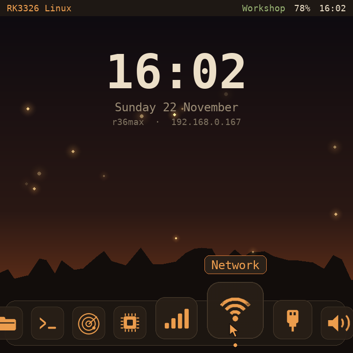
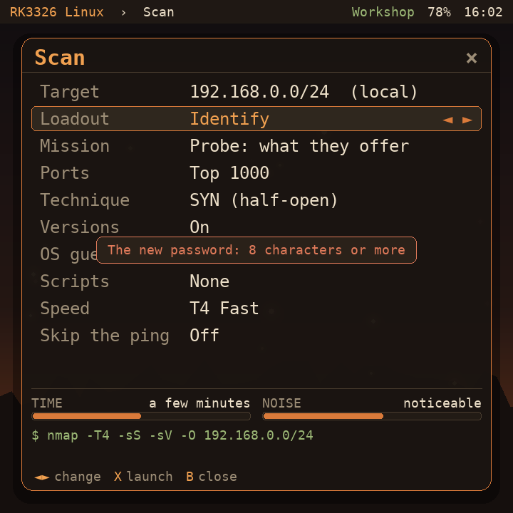
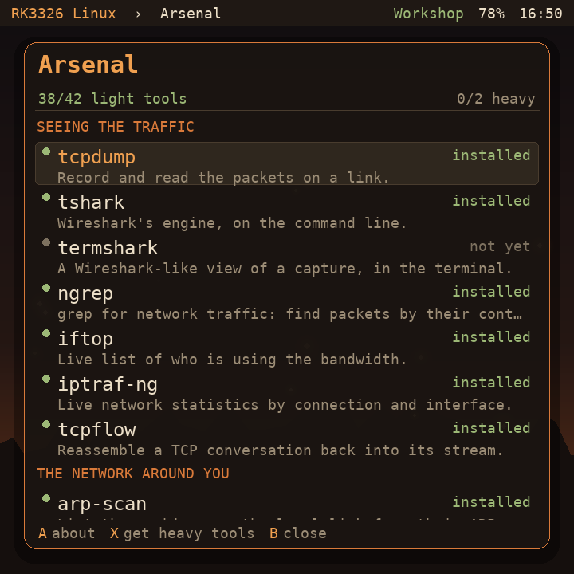

# RK3326 Linux

A small Linux system for RK3326 handhelds (R36MAX first, R36S next), built
as one SD card image: flash it, put it in the handheld, switch on. The
current release is on the [Releases](../../releases) page; what changed in
each one is in [`CHANGELOG.md`](CHANGELOG.md).


It is our own system, not a desktop distribution squeezed onto a 4-inch
screen: a minimal Debian 13 (trixie) on the boot chain and kernels of
[arkos4clone](https://github.com/lcdyk0517/arkos4clone), with a
gamepad-first desktop and FireFly, the Stump, Ember and the Provisioner built
in, for teaching and authorised testing on your own equipment.

> **Status: 1.3.1 runs on an R36MAX (type 1 board), tested through 2026-11-26: its first start on a new card and on a card flashed again (RKSHARE and `/data` made, then kept), a 1.2.8 card given RKSHARE from Settings, RKSHARE opened on a Mac, `rk-paths`, the boot logo on a flashed card (as 1.3.0), and the logo arriving with an update from Settings. Every other handheld in [`docs/devices.md`](docs/devices.md) is checked by the build only; nobody has started the image on one yet.**
>
> *Works on that handheld:* kernel 5.10, the screen, the desktop and its
> pointer, a USB keyboard, Wi-Fi on an RT3070 dongle, SSH, the data
> partition and RKSHARE, power-off and restart, charging, updating from
> Settings, the CH340 serial driver, the Provisioner, AppManager, the
> FireFly, Stump and Ember apps, the volume keys, the speaker and 3.5 mm jack
> switching, a USB microphone, and the Wi-Fi adapter-readiness check.
>
> *In the image but not yet tried on a handheld:* Wi-Fi dongles other than
> the RT3070, USB Ethernet, a USB mouse, the 4.4 fallback kernel's drivers
> for them, and RKSHARE under the 4.4 kernel.
>
> *Not tried at all:* any other handheld, the R36S included.
>
> *Known problems:* Ember makes no sound yet, and an app can leave the
> display's hardware cursor frozen over the desktop after it quits (a
> restart clears it).
>
> The build also checks what can be checked without hardware, including a
> rehearsal of the first start's partition step.

## What the image does

- Starts kernel **5.10** (arkos4clone calls it experimental); kernel **4.4**
  is on the card as a fallback.
- Boots to its own **desktop**, driven by the gamepad: a dock at the bottom
  whose icons grow under the cursor, and windows for Files, Terminal, Scan,
  Arsenal, Survey, Network, Devices, Sound, AppManager and Settings. A USB keyboard works too.
- The **left stick moves a pointer** over all of it; A presses what it is
  on. A USB mouse does the same.
- **Terminal**: a real shell in a window, with an on-screen keyboard.
- **Scan**: nmap as a loadout. Pick a target, equip the scan (mission,
  ports, technique, versions, OS guess, script packs, speed), see what it
  costs in time and noise, launch.
- **Arsenal**: the security toolset, grouped, showing what is installed. The
  light tools are in the image; the heavy ones (Metasploit, exploitdb) are
  fetched when you ask: X in Arsenal, on Wi-Fi.
- **Survey**: every Wi-Fi access point in range, with its channel, signal
  and security, and how crowded each channel is.
- Joins the Wi-Fi network you put in `wifi.txt`, or one you pick in the
  Network window. A **network cable** on a USB adapter or hub connects by
  itself.
- **Remote access (SSH) is off on a new card.** You turn it on in the
  Network window, and the handheld asks you to choose its password first:
  the first one is the same on every card, so SSH never opens on it.
- **Looks after the battery**: a warning at 10% and at 5%, and at 3% it
  powers off properly instead of losing power in the middle of a write,
  also while a game or an app has the screen. The **screen goes dark** after
  5 minutes without a button (Settings: 1 to 30 minutes, or never).
- **Your time zone**, chosen in Settings; the choice survives a reflash.
- **Update this handheld** also applies Debian's security updates, shows the
  version you have and the one you would get, and asks before it starts.
- **Reset this handheld**, light (the settings) or full (the settings and
  what the apps hold), without a reflash.
- **Updates itself** from Settings, without a reflash and without touching
  your data ([`docs/updates.md`](docs/updates.md)).
- Makes its own SSH host keys, a data partition and **RKSHARE** at the
  first start. RKSHARE is the part of the card a Mac or a PC opens: games,
  BIOS files and app packages are copied there with the card in a computer
  (see [The card](#the-card)).
- Shows its own picture at switch-on, in every panel's size.

On the dock as well: **FireFly**, **Stump** and **Ember** — our own apps,
built into the image. FireFly and Ember are ready on a fresh card; the Stump
asks a few questions the first time you open it. With them, the
**Provisioner** (flashes ESP32 boards). **AppManager** updates these, and
installs any other app from a package, a `.zip` copied to the card: an app
is added, updated or removed without the system changing. That, and the
**Sound** window (jack, USB audio, a mic recorder), are in
[`docs/apps.md`](docs/apps.md).

Also on the dock: **Video** (search YouTube and watch, with the pad) and
**Games** (RetroArch, for your own game files). On the R36MAX, Video searches
and plays (it is slow to start) and Games opens and runs fast; no game has
been played through yet. Both are in [`docs/media.md`](docs/media.md).

**Wi-Fi auditing** (monitor mode, injection) needs a USB adapter: the onboard
radio is client-only, as on any RK3326 device. Arsenal shows whether the
plugged-in adapter is ready — see [`docs/arsenal.md`](docs/arsenal.md).

### Wi-Fi dongles and Ethernet

Plug it in and it should work: there is nothing to install. What decides
whether an adapter works is the chip inside it, not the name on the box, and
the same product name is sometimes sold with different chips.

**USB Wi-Fi** — the 5.10 kernel has drivers, and the image has the firmware,
for these chips:

| Family | Chips |
|---|---|
| Realtek, Wi-Fi 4 | RTL8188EU, 8188FU, 8188GU, 8192CU, 8192EU, 8723BU, 8723DU |
| Realtek, Wi-Fi 5 | RTL8811AU, 8812AU, 8814AU, 8811CU / 8821CU, 8812BU / 8822BU |
| Realtek, Wi-Fi 6 | RTL8852BU |
| MediaTek / Ralink | MT7601U, MT7610U, MT7612U, RT2870, RT3070, RT3572, RT5370, RT5572 |
| Atheros | AR9271, AR7010, AR9170 |
| AIC | AIC8800 (the small, cheap Wi-Fi 6 dongles) |
| Older | ZyDAS ZD1211, Prism54, Marvell and Broadcom USB |

Tested on a handheld so far: **RT3070**. The rest is what the drivers cover;
tell us what works and what does not, and this list becomes a tested one.
**Not supported yet** (no driver in these kernels): MediaTek MT7921AU and
Realtek RTL8852AU / RTL8832AU, both Wi-Fi 6.

**Ethernet** — a USB Ethernet adapter, or a USB hub or dock with a network
socket, connects by itself as soon as the cable is in (DHCP); the menu bar
shows *Ethernet* and the **Network** window shows the address. The usual chips
are all covered: Realtek RTL8152 / RTL8153, ASIX AX88772 and AX88179,
Microchip LAN78xx and SMSC95xx / 75xx, Davicom DM9601, and anything that
follows the USB standard for network adapters (CDC Ethernet / NCM, which
includes most 2.5-gigabit adapters and phones sharing their connection).
None has been tested on a handheld yet.

If an adapter does nothing, plug it in and run `lsusb` and `sudo dmesg | tail
-20` in the Terminal: the first line names the chip, the second says whether
a driver took it and whether a firmware file was missing.

### The desktop

| Button | Does |
|---|---|
| D-pad left / right | move along the dock |
| A | open what is selected, or what the pointer is on; choose |
| B | close the window; go back |
| X | more actions (in Files) |
| START | confirm what you typed on the on-screen keyboard |
| SELECT+START | quit an app, back to the dock |
| Volume keys | volume |
| Left stick | move the pointer |



The **left stick moves a pointer** everywhere on the desktop: over the dock,
in every window, on the on-screen keyboard. Point at something and press
**A** to press it; on nothing, A does nothing. The **×** at the top of a
window is the same as B. On the dock the icon under the pointer grows as the
selected one, and resting the pointer near the left or right edge of the
screen brings in the icons that did not fit. The pointer goes away after
three seconds of rest, or as soon as you use the d-pad, and then A is the
d-pad's again. A USB mouse works too: left button
presses, right button is B, the wheel is up and down.

The stick is a real virtual mouse (`rk-mouse`), so apps opened from the dock
and any X or SDL program see a mouse as well; there the triggers click and the
shoulders are the wheel, since A belongs to the app (what an app must do
about it is in [`docs/building-apps.md`](docs/building-apps.md#the-pointer)).
Turn it on or off in
**Settings → Left-stick mouse**. Speed, dead zone and the button map are in
`/data/ark/rk-mouse.json`.

In the **Terminal**, the D-pad is the arrow keys, A is Enter, Y is Ctrl+C,
START is Tab, L1/R1 scroll back and X opens the keyboard (then: A types,
B deletes, X space, Y shift, L1 more keys, L2 Tab, R2 Ctrl+C, START Enter,
SELECT hides it). The shell keeps running while the window is closed.

**Scan** is nmap, set up like a loadout before a match:



| Row | nmap |
|---|---|
| Target | an address, a name, a range (`192.168.0.1-50`) or a network (`192.168.0.0/24`); A lists your own, or lets you type one |
| Loadout | ready-made sets: Quick look, Sweep, Identify, Quiet, Everything |
| Mission | Sweep `-sn` (who is there) or Probe (what they offer) |
| Ports | top 100 `-F`, top 1000, all `-p-`, or a list you type `-p 22,80` |
| Technique | SYN `-sS`, Connect `-sT`, UDP `-sU` |
| Versions / OS guess | `-sV` / `-O` |
| Scripts | the `default`, `safe` or `discovery` packs (`--script=`) |
| Speed | `-T2` to `-T5` |
| Skip the ping | `-Pn` |

D-pad left/right changes a row, X launches, B stops a scan that is running.
The two gauges are rough guides to how long the loadout takes and how
visible it is on the network, and the line under them is the exact command.
In the results, A opens a host, X aims the next scan at it, Y saves the
report to `/data/ark/scans`, where Files shows it.

The scan runs as root (SYN, UDP and OS detection need it) through `rk-scan`,
which builds the command from the loadout and refuses a target that is
really an nmap option, so the desktop cannot make root write files or run
scripts. It does **not** limit where you aim: any address can be typed.
Scan only networks that are yours, or that you have been asked to test.

### The toolset

**Arsenal** lists the security tools by group, with a dot for what is
installed and a line on what each one is for:



The light tools ship in the image. The heavy ones — Metasploit and a local
copy of Exploit-DB — are large, so they are **not** flashed; press **X** in
Arsenal while on Wi-Fi and `rk-tools` fetches them (Metasploit into the
system, Exploit-DB into `/data/opt`). The root partition is sized to leave
room; because empty space compresses away, the image you download stays
small.

Every tool runs from the **Terminal**. Plug in a USB keyboard for the big
keyboard-driven ones (Metasploit's console especially). Adding a tool the
image does not carry is a normal `sudo apt install` away.

See [`docs/arsenal.md`](docs/arsenal.md) for the full list, the Wi-Fi
monitor-mode note, and how to install Metasploit by hand if the automatic
fetch has no build for this CPU. Use these on networks and machines that are
yours, or that you have been asked to test.

**Building apps for the dock.** An app is any program plus one small JSON
file. The full contract — the dock entry, how an app gets this screen and the
controls, how sound is routed, how two apps take turns, and how updates are
delivered — is in **[`docs/building-apps.md`](docs/building-apps.md)**, for
Team r36max and anyone making apps for this or another build. The short field
reference is [`overlay/usr/share/rk/apps/README`](overlay/usr/share/rk/apps/README).

A text login is always one key press away on a USB keyboard:
**Ctrl+Alt+F2** (and **Ctrl+Alt+F1** to come back). If the desktop cannot
start, the text login takes its place on the screen.

The desktop is the Python package in [`shell/rkshell`](shell/rkshell). It
runs in a window on any computer (`python3 -m rkshell --window --demo`
from `shell/`), and draws every screen to PNG files with `--shots DIR`.

## Which handhelds

One image for every RK3326 handheld
[arkos4clone](https://github.com/lcdyk0517/arkos4clone) supports: the R36S
and its clones, the R36MAX, R36 Plus/Pro/Ultra, the XiFan, GameConsole and
Powkiddy RK3326 models, the RG351 family, the Odroid Go Advance and more; the
full list is in [`docs/devices.md`](docs/devices.md). The image starts on the
R36MAX (type 1) as downloaded; for another handheld, pick it on the card's
boot partition before the first start (`Choose handheld.command`, or
`README.txt` there for doing it by hand).

Started and used by a person: the R36MAX only. Every other handheld is
checked by the build from its device tree (boot files, screen size and
turn, pad, power chip), which is a good reason to expect it to work and not
the same as someone having held it. Reports are welcome.

## Flash it

1. Download `rk3326-linux-r36max-<version>.img.xz` from the latest
   [build](../../actions/workflows/build.yml) (the **Artifacts** of a run) or
   from [Releases](../../releases).
2. Write it to an SD card with [balenaEtcher](https://etcher.balena.io) or
   Raspberry Pi Imager (*Use custom*). Both read the `.xz` file directly.
   The image needs 8 GB; **16 GB or more** is the size to use, because a
   card needs about 2 GB free after the system to get the partition a
   computer can read.

   From a Mac's Terminal instead (`diskutil list` names the card: the
   external disk of the card's size; a wrong number erases another disk).
   Give the file's whole name, not `*`: with two images in the folder, a
   pattern writes both.

   ```sh
   diskutil unmountDisk /dev/diskN
   xz -dc rk3326-linux-r36max-<version>.img.xz | sudo dd of=/dev/rdiskN bs=4m
   diskutil eject /dev/diskN
   ```
3. Take the card out and put it back in. A partition named **BOOT** shows up.
   (After the first start there is a second one, **RKSHARE**, for your
   games and app packages.)
4. Open `wifi.txt` on it, fill in `SSID` and `PASSWORD`, save, eject.
   Optional: add a file named `authorized_keys` with your SSH public key
   (used once you have turned remote access on, see [Log in](#log-in)).
   From a Mac's Terminal, the same in one line (double quotes, so that a
   name like `Bob's Wi-Fi` works), then a look at the result:

   ```sh
   printf 'SSID=%s\r\nPASSWORD=%s\r\nCOUNTRY=CA\r\n' "Network name" "the password" > /Volumes/BOOT/wifi.txt
   cat /Volumes/BOOT/wifi.txt
   ```
5. Put the card in the handheld, plug in the Wi-Fi dongle, switch on.

## Log in

The desktop needs no login: it runs as `ark`. Logging in from a computer
(SSH) is **off** on a new card, because every card starts with the same
password, `ark`. To turn it on, on the handheld: **Network → Remote access
(SSH)**, press A. The first time, you choose the handheld's own password
(8 characters or more) on the on-screen keyboard; then SSH starts, and the
window shows the line to type:

```sh
ssh ark@r36max.local
```

That password is the one `sudo` asks for, and the one updates and installs
ask for on the handheld. A key in `authorized_keys` on BOOT works from then
on too. The same row turns SSH off again.

A card updated from an older version keeps SSH as it was if its password
was already changed; if it still had the first password, the update turns
SSH off until you choose one. With a USB keyboard, the text login on the
handheld (Ctrl+Alt+F2) still takes `ark` once and makes you change it.

## Battery

The bar at the top shows the charge. Running on the battery, the desktop
warns at 10% and again at 5%, and the handheld powers off by itself at 3%:
a battery that runs out cuts the power in the middle of whatever was being
written, and that is how cards get damaged. The power-off is a service of
its own (`rk-battery`), so it also works while a game or an app has the
screen, where the warnings cannot show. It waits for three low readings in
a row, never acts in the first two minutes after a start or while charging,
and does nothing when the gauge's voltage says the battery is not empty.
To switch it off: `sudo systemctl disable --now rk-battery`.

**The screen's sleep.** After 5 minutes without a button, the stick or a
mouse, the desktop switches the screen's light off and stops drawing; the
handheld itself keeps running (Wi-Fi, SSH, a Stump). Any button lights it
again, and that press does nothing else. **Settings → Screen off after**
steps through 1, 2, 5, 10 and 30 minutes and Never. It stays lit while a
window is working by itself (a scan, an install, an update, the card being
prepared) and while a game or an app has the screen, and a new message such
as the battery warning lights it. Only the light is switched, not the
panel. It is not a suspend: the handheld does not go to sleep.

## Reset

**Settings → Reset this handheld** offers two, and asks twice (Cancel comes
first), then for the handheld's password. The handheld restarts at the end.

| | Light | Full |
|---|---|---|
| Saved Wi-Fi networks | erased | erased |
| The password | back to `ark`, to be changed | same |
| Remote access (SSH), its keys, the card's own SSH keys | off, forgotten, made anew | same |
| Time zone, the desktop's settings, where updates come from | back to the image's | same |
| FireFly's identity and messages | kept | erased: FireFly makes a new identity |
| The Stump's setup | kept | erased: it asks its questions again |
| Apps installed from a package | kept | removed (their `.zip` files stay) |
| Saved scans, files given to apps, the terminal's history | kept | erased |
| The system, its version, FireFly, Ember, the Provisioner, the heavy tools | kept | kept |
| Everything on RKSHARE: games, saves, BIOS files, packages | kept | kept |

A handheld still on its first password is not asked for one. From a
terminal: `sudo rk-reset light` or `sudo rk-reset full`.

It is not a secure erase: erased files are not written over. Before a card
goes to somebody else, flash it again. After a light reset, a Stump that
starts by itself may wait until the handheld has a password again.

## Time zone

The image is built with `America/Toronto`. **Settings → Time zone** changes
it: the part of the world, then the city. The clock itself comes from the
network (there is no clock battery), the zone says how to show it. The
choice is kept on the data partition, so a reflashed card takes it back at
its first start. From a terminal: `sudo rk-region tz Europe/Paris`.

The first start takes about a minute longer than later ones.

If SSH warns that the host identification has changed, your computer
remembers another card under the same name: `ssh-keygen -R r36max.local`,
then connect again. If nothing answers, the login screen on the handheld
shows its Wi-Fi address; when that is empty it did not join the network.
With a USB keyboard, log in there and run `nmcli dev wifi list`, then
`sudo nmcli dev wifi connect "Network name" password "the password"`.
Most USB dongles only see 2.4 GHz networks.

## If it does not start

The card starts kernel 5.10. If the screen stays black or the start stops:

1. Put the card in your computer and open **BOOT**.
2. Copy the three files in `fallback-4.4/` to the top of the partition,
   replacing the ones there.
3. Eject, try again.

`default-5.10/` holds the same three files for the 5.10 kernel, to go back.

On the handheld itself, the same choice is one command:

```sh
sudo rk-boot-select status
sudo rk-boot-select kernel 4.4            # or 5.10
sudo rk-boot-select list                  # every handheld on the card
sudo rk-boot-select set "r36max type3" 5.10
```

The R36MAX exists in three board variants. The image is built for
`r36max type1` (external speaker amplifier). `r36max type3` is the same
screen without the amplifier, `r36max type2` has no amplifier and
different screen pins.

The image changes arkos4clone's device trees in the places listed in
[`build/dtb-fixes.txt`](build/dtb-fixes.txt), each with its reason. What
was changed on a card is in `rk-dtb-fixes.txt` on its BOOT partition.

## Updating

The handheld updates **in place — no reflash — from Settings → Update this
handheld**, or `rk-update apply`. An update replaces only the desktop and
system files (never the kernel, your apps or your data), checks the new
version draws before swapping it in, backs up the old one, and rolls back by
itself if the desktop doesn't come back. Adopter state — the mesh identity,
apps and settings — lives on the `/data` partition, which a reflash keeps
(as it keeps RKSHARE, with your games), so even a kernel reflash loses
nothing. See [`docs/updates.md`](docs/updates.md).

## The card

| Where | What |
|---|---|
| sectors 64, 16384, 24576 | boot chain (idbloader, u-boot, trust) |
| partition 1, FAT32 `BOOT`, 256 MiB | kernel, device tree, `boot.ini`, settings files, boot files for every handheld in `consoles/` |
| partition 2, ext4 `RKROOT`, 6 GiB | the system |
| partition 3, ext4 `RKDATA`, 16 GiB | your data, on `/data`. Made at the first start. Flashing a new image keeps it. |
| partition 4, exFAT `RKSHARE`, rest of the card | **the part a computer shows** when the card is in its reader: `roms/` for games and BIOS files, `packages/` for apps. `/share` on the handheld. Made at the first start; flashing a new image keeps it. |

A card whose `/data` fills it (flashed before the visible partition existed)
gets one from **Settings → Show the card on a computer**, or `sudo rk-share
request`: `/data` is made smaller at the next start, with what is in it
kept. On a card too small for both, `/data` keeps all of it.

Flashing an image from before RKSHARE existed (1.2.8 or older) over a card
that has one loses what is on RKSHARE: that system does not know the
partition and takes its room back for `/data`.

An app does not write these paths into its code. It asks `rk-paths`
(`rk-paths list` shows what it answers): see
[`docs/building-apps.md`](docs/building-apps.md#where-files-live).

## Build

GitHub builds the image for every pull request, every push to `main` and
every `v*` tag ([workflow](.github/workflows/build.yml)); a branch with no
pull request is not built. To build by hand, on an arm64 Linux machine with
Debian trixie's tools (the workflow's `apt-get install` line lists them;
`python3-pygame` makes the boot logos):

```sh
. build/upstream.env
git clone --filter=blob:none --no-checkout "$UPSTREAM_REPO" upstream
git -C upstream sparse-checkout set --no-cone /uboot/ /boot/dArkOS/consoles/ /dtbTools/internal/console/ /rootfs/dArkOS/usr/lib/modules/ /rootfs/dArkOS/usr/lib/firmware/
git -C upstream checkout "$UPSTREAM_COMMIT"
build/build-kernel-modules.sh kmods upstream/rootfs/dArkOS/usr/lib/modules/5.10.252-arkos4clone/kernel/drivers/usb/serial/cp210x.ko
sudo CONSOLE="r36max type1" KERNEL=5.10 KMODS="$PWD/kmods" build/build-image.sh upstream out
```

| File | What it is |
|---|---|
| `build/upstream.env` | the arkos4clone commit and the Debian release the image is made from |
| `build/build-image.sh` | installs Debian, adds the kernels' modules and our files, assembles the image |
| `build/verify-image.sh` | the checks that need no handheld; the build fails if one fails |
| `build/kernel-modules.env`, `build-kernel-modules.sh` | kernel modules arkos4clone's 5.10 kernel is built without (the CH340 serial driver), built from its source; also made into `rk-kernel-modules-<n>.tar.xz` for the releases |
| `build/dtb-fixes.txt` | our changes to arkos4clone's device trees, applied at build time |
| `overlay/usr/lib/rk/bootlogo.py`, `overlay/usr/share/rk/boot-logo/` | the boot logo: the picture (`logo.jpg`), how it is turned for each panel (`turns.txt`), and the program that makes it for every panel, at build time and once on an updated card |
| `build/check-consoles.py` | reads every handheld's device tree and writes [`docs/devices.md`](docs/devices.md) |
| `build/emulators.env`, `build-emulators.sh` | RetroArch and its cores, for Games |
| `build/packages.txt`, `packages-tools.txt`, `packages-media.txt`, `packages-optional.txt` | what is installed |
| `overlay/` | our files in the system: the first start (`rk-firstboot`, `rk-data-partition`, `rk-share`), the boot files (`rk-boot-select`, `rk-bootcfg`), updates (`rk-update`, `rk-migrate`), apps (`rk-apps`, `rk-pkg`, `rk-paths`), the desktop's service and its permissions |
| `shell/rkshell/`, `shell/tests/` | the desktop, and the tests the build runs (`test_share.sh`: what `rk-share` does to a card) |
| `boot-files/` | `wifi.txt` and the README that go on the BOOT partition |

## Where the parts come from

- **Boot chain, kernels (4.4.189 and 5.10.252), device trees, kernel
  modules**: [arkos4clone](https://github.com/lcdyk0517/arkos4clone) by
  lcdyk and contributors, at the commit in `build/upstream.env`. The Linux
  kernel and u-boot are GPL-2.0; their sources are linked from that project.
- **The system**: [Debian](https://www.debian.org) 13, including packages
  from its `non-free-firmware` section (firmware files for Wi-Fi dongles).

## Licence

What is written for this repository is under the [MIT licence](LICENSE):
the desktop, the `rk-*` programs, the build scripts, the docs, and the boot
logo picture.

Three things are not ours to license and keep their own terms:

- **What the image carries.** The Linux kernel and u-boot (GPL-2.0), Debian's
  packages (each its own licence), the Wi-Fi firmware files (redistributable,
  not free software) and RetroArch with its cores (GPL-3.0 and others). The
  MIT licence above covers how the image is put together, not these parts.
- **The two files in [`build/patches/`](build/patches)** change RetroArch's
  source, so they are under RetroArch's licence, GPL-3.0-or-later.
- **arkos4clone's files**, fetched at build time, are under its MIT licence
  (lcdyk).

Kernel 4.4 no longer receives security fixes, and 5.10 reaches the end of
its upstream support at the end of 2026. Treat the handheld as a lab tool.
