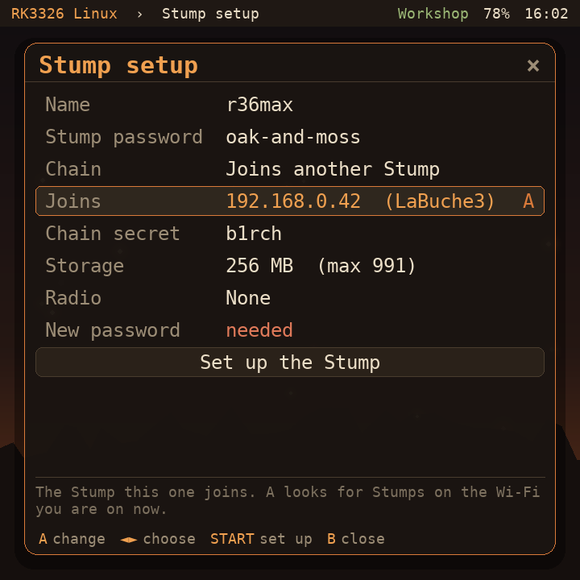
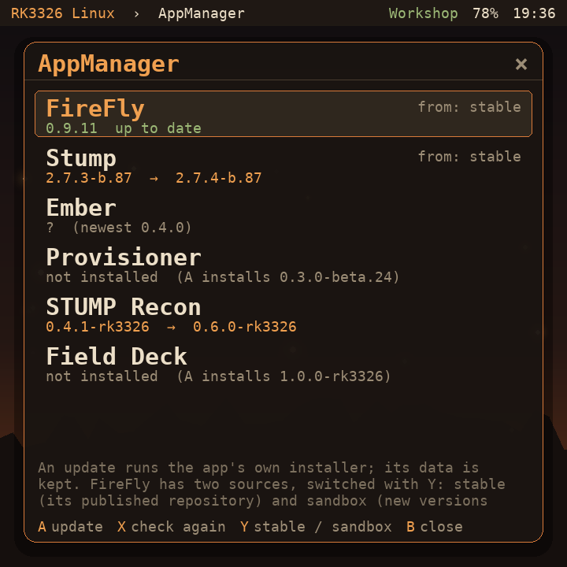
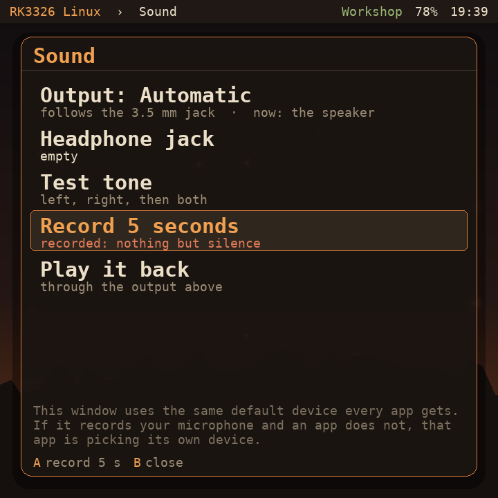

# The dock apps: FireFly, Stump, Ember, Provisioner, STUMP Recon

> Making an app of your own? The builder's contract is in
> [`building-apps.md`](building-apps.md). This page is about using these five.

> Video and Games (mpv and RetroArch) are in [`media.md`](media.md).

These are your own programs ported onto the desktop. Since 1.1.0 they
are in the image: a freshly flashed card has Ember and FireFly ready on the
dock, and the Stump's files in place with only its setup left to answer (see
below). The Provisioner joined them in 1.2.0, and STUMP Recon after it. Each is a full-screen app: when you open it the desktop steps aside
and comes back when you quit it (for FireFly and Stump, SELECT+START returns).

They live under `/home/ark`, where the dock's launchers look. A USB keyboard
helps with all of them. A card that came from an older image and has since been
updated may still show one as **(not installed)**; fetch it over Wi-Fi from
the Terminal:

    rk-apps install all        # or: ember | firefly | stump | provisioner | stump-recon
    rk-apps status

## Ember — analog pads and a vocoder

A prebuilt arm64 binary, so this is the simplest: it is unpacked into
`/home/ark/ports`. It uses SDL2 and ALSA, which are in the
image. Audio comes out of the USB-C port (the jack's left channel is a
hardware fault on this handheld). To rebuild from source instead:
`sudo apt install build-essential libsdl2-dev libsdl2-ttf-dev libasound2-dev`
then run its `Ember.sh`, which compiles once.

## FireFly — messages over LoRa and Wi-Fi

FireFly is installed when the image is built, by its own installer: a Python
virtual environment in `/home/ark/firefly`, with Reticulum (`rns`/`lxmf`) from
pip. Installing it again by hand (`rk-apps install firefly`) therefore needs
internet. The packages it depends on (python3-venv, python3-serial, python3-cryptography,
opus-tools, codec2) are already in the image. Plug an RNode LoRa board into USB
for the radio; it also works over Wi-Fi/LAN without one.

## Stump — this handheld as a mesh node

The Stump's files are in the image, but its setup is yours to answer: its
name, its password, whether it is part of a chain, and its radio. Until that
is done, the dock shows it as **Stump (set up)** and opens a setup window in
place of the cockpit:

Fill it in with the gamepad and press START. The window hands the answers to
the Stump's own installer (`R36MAX-Stump/handheld/install.sh --answers`, the
same way the RK3326 Provisioner drives it) and shows its progress. It needs
Wi-Fi, takes a few minutes, and asks for this handheld's password because the
installer needs root for a few steps. The password goes to `sudo` and is not
kept; the answers file is removed when the installer ends.

**Storage** is the room for what visitors share. The window offers only
sizes that fit the space free on the system partition, as the Stump's own
wizard would allow.

For a Stump that joins another, the window looks for Stumps on the Wi-Fi the
handheld is on and lists them, so no address is typed. On a card whose
password has never been changed, the window asks for a new one and sets it
first (the starting password is refused by `sudo`); that is the password for
SSH too.

The window covers a Stump on its own, the first Stump of a chain, or one
that joins another Stump on the Wi-Fi the handheld is on. For anything else
(Bluetooth radio, joining a Stump's own hotspot), run the installer in the
Terminal: `bash ~/R36MAX-Stump/handheld/install.sh`.

## Provisioner — the board bench

**Workshop → Provisioner** on the dock. It flashes ESP32 boards, makes a
Stump on a board, and puts packs on it. It does not install or update the
apps on this handheld: the AppManager window below does that.

It is in the image, from its newest release, with the rule that lets `ark`
open USB serial boards. A card from before that shows it as **(not
installed)** after an update: open **AppManager**, go to its row and press A, or
run `rk-apps install provisioner`. Its releases come from
`SandBox_RK3326_Provisioner`, the only repository it has today, and each
download is checked against the release's SHA-256 before its installer runs.

A board with a CH340 chip (most ESP32 boards) gets a serial port on kernel
5.10; see [`devices.md`](devices.md).

## STUMP Recon — LoRa and 2.4 GHz recon

**Comms → STUMP Recon** on the dock. It listens through a board on USB (a
Heltec V3, or another ESP32 board with the STUMP RF Recon firmware; a CH340
board gets its serial port on kernel 5.10), through a USB Wi-Fi adapter, or
through both, and shows what it hears: LoRa and 2.4 GHz traffic, signal
levels, and each frame taken apart. It only listens; it sends nothing. X and Y in the
frame view save a capture (`.pcap`, `.chlsj`, `.json`). SELECT+START quits.
For your own radios and ones you are allowed to test.

- Captures and its `debug.log` go to `/data/ark/stump-recon/exports`, on the
  data partition: they are in the **Files** window and survive a reflash.
- **A Wi-Fi adapter that can monitor** (RT3070 and other `rt2800usb`,
  AR9271, MT7601U/MT7612U, the Realtek 8812au/8821cu/8822bu/8188eu families)
  is switched to monitor mode while the app is open, and hops the 2.4 GHz
  channels. **It is off the network for that time.** If it is the handheld's
  only Wi-Fi (an R36MAX with one dongle), Wi-Fi and SSH stop when you open
  STUMP Recon and come back a few seconds after you quit. With two adapters,
  set which one it takes: `STUMP_WIFI_IFACE=wlan1` before its launcher.
- **A Wi-Fi adapter that cannot monitor** stays connected: the app reads the
  list of networks it sees instead (names, channels, levels; no frames).
- The capture runs as root through one helper,
  `/usr/local/sbin/rk-stump-wifi`, which the app's installer puts there with
  a line in `/etc/sudoers.d/stump-recon-wifi` so `ark` may run it without a
  password. `rk-stump-wifi --probe` lists the adapters it sees and which one
  it would take.
- While it is open the Stump is paused, as for FireFly: both want the board
  on USB. It comes back when you quit.
- The left stick is not a mouse while it runs (it uses the stick and the
  shoulder buttons itself).
- It draws for 720×720 and scales that onto other panels.

Its files travel with the system (`/usr/share/rk/bundled/stump-rf-recon`,
the app's own RK3326 release, unchanged). A flashed card has it installed. A
card that is updated shows it as **(not installed)** until you open
**AppManager**, go to its row and press A: that needs no Wi-Fi, the files
are already on the card. It asks for the handheld's password, for the helper
above. From a terminal: `rk-apps install stump-recon`. Once
its repository (`stump-rf-recon`) publishes a higher version on its `main`
branch, AppManager offers that one.

Not yet tried on a handheld: the build starts it with no screen and no board, and
nobody has opened it on an R36MAX with a board plugged in.

## Updating them

The **AppManager** window on the dock (named Apps until 1.2.0) shows each
app's version here and the newest one, and updates it with A:

An update runs the app's own installer, so its data and settings are kept as
that installer keeps them. FireFly and the Stump are taken from the `main`
branch of their repositories (their GitHub releases lag behind); Ember from
its latest release, since its binary is only built for releases; the
Provisioner from its newest release, pre-releases included; STUMP Recon
from the copy in the system or its repository, whichever version is higher.
The window
asks for this handheld's password, for the installers' root steps.

FireFly has two sources. **stable** is its published repository
(`FireFly_RK3326_R36MAX_R36S`); **sandbox** is `SandBox_FireFly_RK3326`, where
a new version lands first. Press Y on FireFly's row to switch; the row shows
which one is in use, and the choice is kept in `~/.config/rk-apps`.

The same from a terminal: `rk-apps versions`,
`rk-apps update firefly|stump|ember|provisioner|stump-recon|all` and
`rk-apps source firefly stable|sandbox`.

## Sound and volume

The speaker is switched on at every start (`rk-audio`): this handheld's
sound chip plays nowhere until its output path is set. The volume keys work
on the desktop and while an app is open; the desktop answers them for the
apps, which do not read them. With a USB sound device plugged in (USB-C
headphones, a headset), the keys change its volume, since the sound goes
there; without one, the built-in sound chip's. **Settings** has the same
volume and, when a microphone has a level, a **Microphone** row for it (the
USB device's microphone when there is one).

### Where sound goes: the jack, USB audio, the default device

A small service, `rk-audiod`, owns the routing for every app:

- **The 3.5 mm jack.** This sound chip has one switch for speaker or
  headphones (`Playback Path`), and software has to flip it. The service
  watches the jack and sets it: plug in, the speaker goes quiet and the
  headphones play.
- **USB audio.** While a USB headset or microphone is plugged in, the system's
  `default` device is that one; otherwise the built-in chip. It rewrites
  `/etc/asound.conf` when something is plugged or unplugged (an
  `asound.conf` of your own, without its first line, is left alone). An app
  follows the change at its next start.
- **The built-in chip is shared**, at 44100 Hz with a long buffer (ArkOS's
  settings for this chip), so two programs can play at once.

The **Sound** window on the dock shows what it decided and is the reference
for "does sound work": a test tone (left, right, both), a five-second
recording with a level meter, and playback, all through the same `default`
device apps get. If it hears your microphone and an app does not, that app is
choosing its own device. **Output** overrides the jack (Automatic, Speaker,
Headphones), and if the jack reads the wrong way round on your unit, A on
**Headphone jack** flips it. From a terminal: `cat /run/rk-audio/status`,
`journalctl -u rk-audiod`, `rk-audiod --print`.

## How they get the screen

The panel only shows what goes through the Mali GPU driver, so the image
carries dArkOS's own graphics: its Mali driver (`libmali`, for this G31 GPU)
and the SDL2 it builds against it, in `/usr/lib/rk-gpu`, plus its controller
database in `/usr/share/gamecontrollerdb.txt` (SELECT and START in the right
place on this pad). The desktop gives these to every app it opens; the
desktop itself keeps drawing its own way. A udev rule lets the `video` group
reach the GPU's memory heap, without which apps fail with
"EGL not initialized".

While an app runs it owns the screen, as a port does under EmulationStation,
and the desktop comes back when it quits. If an app crashes on its way out,
the desktop turns the panel back on itself. By hand, the same is
`echo 0 | sudo tee /sys/class/graphics/fb0/blank`.

## FireFly and Stump take turns

Both run Reticulum, and Reticulum's local-network discovery (UDP port 29716)
can belong to only one program on a machine. So while FireFly is open, the
Stump pauses (`rk-stump-pause`, run by the dock before and after FireFly),
and it comes back when you quit FireFly. Opening Stump's cockpit needs
nothing: FireFly is closed then.

## Tested

On an R36MAX, all three open from the dock, draw, take the gamepad, and quit
back to the desktop with SELECT+START; Stump pauses for FireFly and resumes.
Still open: Ember makes no sound yet, and an app can leave the display's
hardware cursor frozen over the desktop after it quits (a reboot clears it).
