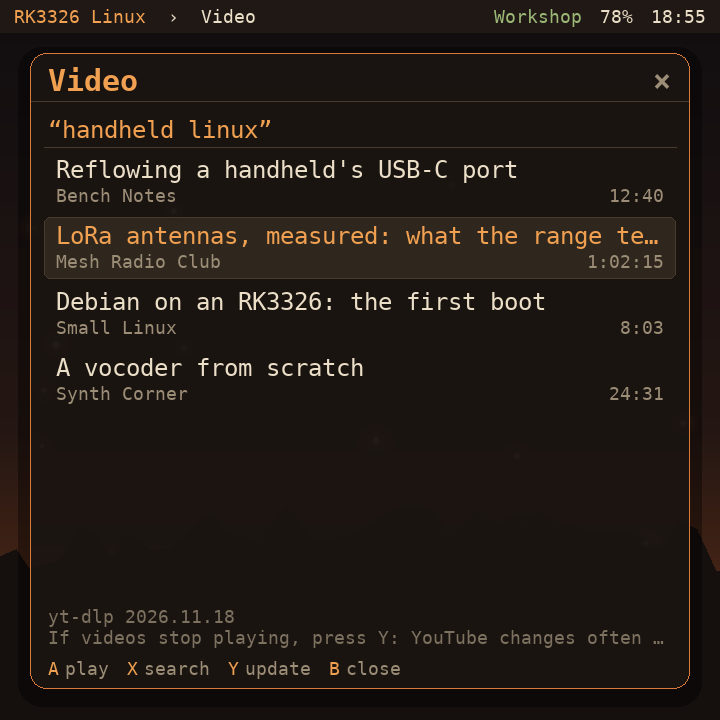

# Video and Games

Two things people expect from a handheld that the security tools do not
cover: watching a video and playing their own games. Both use the same road
to the screen as the other dock apps (SDL2 on dArkOS's Mali driver), and
both leave with **SELECT+START**.

> **Status: new, and not yet proven on a handheld.** The desktop side is
> tested in CI with made-up data. Playing a video and starting RetroArch on
> the panel have to be confirmed on an R36MAX before a release says they work.

## Video

**Video** on the dock searches YouTube and plays the result.

| In the window | |
|---|---|
| X | search (the on-screen keyboard, or a USB keyboard) |
| A | play the chosen result |
| Y | update: the newest yt-dlp, and anything missing |

| In the player | |
|---|---|
| A | pause / play |
| LEFT, RIGHT | 10 seconds back / on |
| UP, DOWN | 1 minute on / back |
| L1, R1 | 5 minutes back / on |
| X | show where you are |
| B, or SELECT+START | stop |

The volume keys work as everywhere.

**How it works.** `rk-video` asks [yt-dlp](https://github.com/yt-dlp/yt-dlp)
for the results and hands the chosen one to `mpv`. The picture is asked for
in H.264 at 480 lines at most (360 on a 640x480 panel), because this
processor decodes video in software and H.264 is by far the lightest.

**yt-dlp is not Debian's.** YouTube changes often and only a recent yt-dlp
keeps up, so `rk-video fetch` (Y in the window) takes the official one from
its releases, checks it against the release's SHA-256 list, and keeps it
unpacked in `~/.local/share/rk-video`. **When videos stop playing, press Y
first.**

**Starting a video takes a while**, because yt-dlp has to run YouTube's own
JavaScript to get the video's address. `fetch` brings
[Deno](https://deno.com/) for that (about 100 MB once unpacked, checked
against its release's checksum). Where Deno does not run on a handheld's
kernel, QuickJS (`qjs`, in the image) does the job, noticeably slower.
`rk-video status` says which one is in use.

Debian's own `yt-dlp` package is never used, even when it is installed: it is
too old for YouTube. When a video does not start, the window says why.

**On a card flashed before this was in the image**, open Video and press A:
it installs the player and RetroArch from Debian and fetches yt-dlp. The
same from a terminal:

    sudo rk-tools install-media
    rk-video fetch

**From a terminal:**

    rk-video status
    rk-video search lora antenna
    rk-video play https://www.youtube.com/watch?v=...
    rk-video play ~/clip.mp4

**Settings** (optional), in `~/.config/rk-video`:

    VO=sdl        # mpv's video output: sdl (default), drm, gpu
    HEIGHT=480    # the tallest picture asked from YouTube

What mpv said the last time is in `~/.cache/rk-video/last.log`.

## Games

**Games** on the dock is [RetroArch](https://www.retroarch.com/), built for
this handheld's GPU, with cores built for its processor by the
[dArkOS](https://github.com/christianhaitian/dArkOS) project:

| Machine | Core | Folder |
|---|---|---|
| PlayStation | PCSX ReARMed | `psx` |
| Nintendo 64 | Mupen64Plus-Next, ParaLLEl N64 | `n64` |
| PSP | PPSSPP | `psp` |
| NES | Nestopia | `nes` |
| Super NES | Snes9x | `snes` |
| Game Boy, Game Boy Color | Gambatte | `gb`, `gbc` |
| Game Boy Advance | mGBA | `gba` |
| Mega Drive, Master System, Game Gear | Genesis Plus GX | `megadrive`, `mastersystem`, `gamegear` |
| PC Engine | Beetle PCE Fast | `pcengine` |

Two cores for the Nintendo 64 because neither runs every game: when one
stutters or shows a game wrongly, try the other.

**No game and no BIOS file comes with the system.** Copy your own into
`/data/ark/roms/<folder>` (over SFTP, or from a USB stick with Files). The
folders are made the first time Games is opened, and they are on the data
partition, so a reflash keeps them along with saves and save states. The
PlayStation core plays better with a BIOS file in `/data/ark/roms/bios`.

In RetroArch: **Load Content**, pick the file, then the core when asked.
**SELECT+START leaves. SELECT+X opens the menu** (save states, options).

The handheld's own settings are in `/usr/share/rk/retroarch/rk.cfg` and are
applied over yours at every start (the picture, the pad, sound, the folders,
the hotkeys). Everything else you change in RetroArch is kept in
`~/.config/retroarch/retroarch.cfg`.

### Where RetroArch comes from

Debian's RetroArch shows nothing on this panel: it draws with desktop OpenGL,
and the panel is only reached through the Mali driver's OpenGL ES. So
`build/build-emulators.sh` compiles RetroArch the way dArkOS does (OpenGL ES
straight to the panel) and packs it with the cores into the **emulator
bundle**, `/opt/rk-emulators` on the handheld. The versions are pinned in
`build/emulators.env`.

- A new image has the bundle in it.
- A card that is already flashed fetches it: the Video window's setup, or
  `sudo rk-tools install-media`. It comes from this repository's release
  **emulators-&lt;n&gt;**, checked against its SHA-256.
- To publish a bundle: raise `BUNDLE` in `build/emulators.env` and the number
  in `overlay/usr/share/rk/emulators.bundle`, then push the tag
  `emulators-<n>`. CI builds it on arm64 and attaches it to a pre-release.

The cores are dArkOS's builds, used as they are. dArkOS's licence notes say
its distribution includes parts licensed for non-commercial use only; keep
that in mind before selling handhelds with this image.

**Not yet proven on a handheld:** that this RetroArch lights the panel, the
pad layout (`autoconfig/udev/GO-Super Gamepad.cfg`, written from the pad's
kernel button order), and how well each core runs. PSP in particular may
need PPSSPP's own asset files beside the core.
