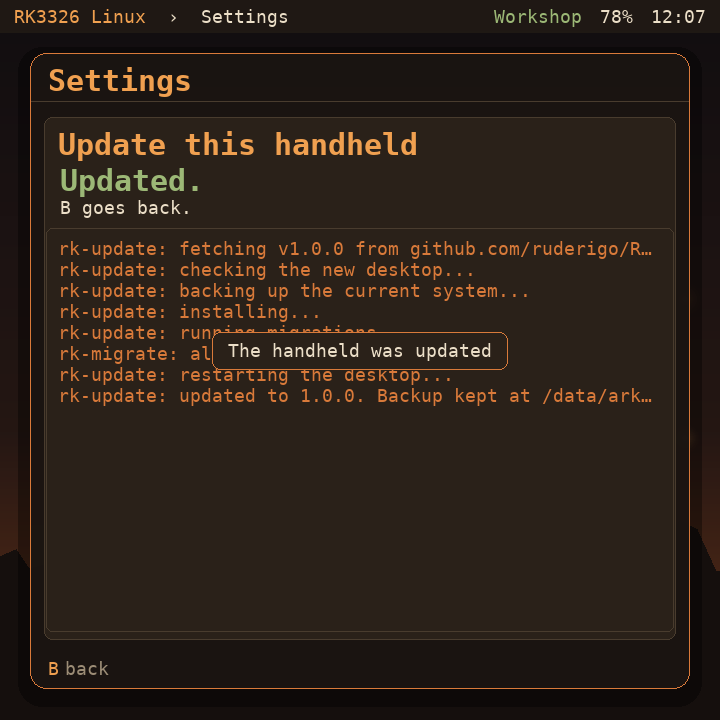

# Updating the handheld without losing anything

The goal: an adopter can take every future version without reflashing, and
when a reflash is unavoidable they lose nothing — not their mesh identity, not
their apps, not their setup. Two mechanisms make that true.

## The two layers

The OS is two layers with very different risk:

- **Soft layer** — the desktop (`rkshell`) and our system files under
  `/usr/local`, `/usr/lib/rk`, `/usr/share/rk`, `/etc/systemd/system` and
  `/etc/udev`. This is almost everything that changes between versions, and
  it's just files. It can be replaced live.
- **Hard layer** — the kernel, device trees and boot chain on the BOOT
  partition. Getting these wrong stops the card booting, so they're changed by
  reflashing a full image.

`rk-update` replaces the **soft layer only**. It never touches the kernel,
`/home` or `/data`, so by construction an update can't lose an adopter's data.

One thing is added beside the kernel, never in place of it: **extra kernel
modules**. arkos4clone's 5.10 kernel is built without a few drivers the
image adds (today `ch341`, the CH340 serial chip of most ESP32 boards). A
flashed image has them; after an update, `rk-migrate` runs
`rk-tools kernel-modules`, which takes `rk-kernel-modules-<n>.tar.xz` from
the system's releases (`/usr/share/rk/kernel-modules.bundle` says which
`<n>`), checks it against its SHA-256, and adds the modules to
`/usr/lib/modules`. The rules that keep this safe:

- a module must say it is built for the very kernel whose folder it goes
  into, or the whole bundle is refused;
- a file the kernel's own build put there is never replaced;
- nothing else changes but the lists `depmod` writes, and a module that did
  not fit would not load: the handheld starts as before either way;
- with no network, or before a release carries the bundle, nothing happens
  and the update goes on.

By hand: `sudo rk-tools kernel-modules`, or from a file with no network,
`sudo rk-tools kernel-modules rk-kernel-modules-1.tar.xz`.

## `rk-update` — live updates, safely

From **Settings → Update this handheld**, or the terminal:

```
rk-update status                 installed vs newest, and the state schema
rk-update apply                  update to the newest version
rk-update apply --to v1.2.0      update to a specific tag
rk-update rollback               put the last version back
rk-update source official        updates from ruderigo/RK3326_Linux (default)
rk-update source fork OWNER/REPO updates from a fork
rk-update source url URL [SHA256] updates from a tarball (optional checksum)
```

An `apply` is deliberately paranoid, because a bad desktop update would
otherwise drop someone to a text login:

1. **Fetch** the new version to a temp dir — a git tag on your repo or a fork
   (pinned to the tag's commit), or a tarball you can checksum.
2. **Check** it before touching anything: the new desktop must compile and
   actually draw (the same check the image build runs). If it doesn't, nothing
   changes.
3. **Back up** the current soft layer to `/data/ark/.rk-backups`.
4. **Swap** in the new files and set the version.
5. **Migrate** the state (below).
6. **Restart** the desktop — and if it doesn't come back, **roll back to the
   backup automatically**.

Updates come from git tags by default; a fork or a checksummed tarball are
there for people running their own builds. Pulling and running code as root
from a source means trusting it — stick to sources you control.

## Migrations — so the layout can change without stranding anyone

You can't promise the state layout never changes. What you *can* promise is
that every change ships with a migration that runs itself. `rk-migrate` keeps
a **state-schema number** on `/data` (so it survives a reflash, because it
describes `/data`'s own layout) and runs the numbered steps in
`/usr/lib/rk/migrations/` that are newer than the card's recorded number. Each
step is idempotent and safe to re-run; the number is advanced only after a
step succeeds. It runs at every boot (a no-op once the card is current) and
after every `rk-update`.

So moving something is never a manual migration for the adopter — it's a
numbered step that runs on their next update or boot.

## What survives a reflash, and why

The card has three partitions; a reflash replaces only the root partition and
**keeps RKDATA (`/data`)**. The persistence rule is therefore: all adopter
state lives on `/data`. Migration **0001** moves the apps' folders — the
FireFly/Stump Reticulum **identity** (the node's address on the mesh), their
config, and the Stump's working data — onto `/data/ark` and leaves a symlink
behind, so:

- the apps still find their files at the old paths, and `rk-apps` still updates
  them in place;
- a reflash keeps the identity and setup, and on the next boot migration 0001
  re-links the fresh image's folders to the adopter's `/data` copy, **keeping
  their copy over the image's baked default**.

One limit worth stating plainly: this protects against losing data, not
against a dead SD card. The same `/data`-backed design is what a future
`rk-backup` would snapshot so a copy can be kept off the device.


